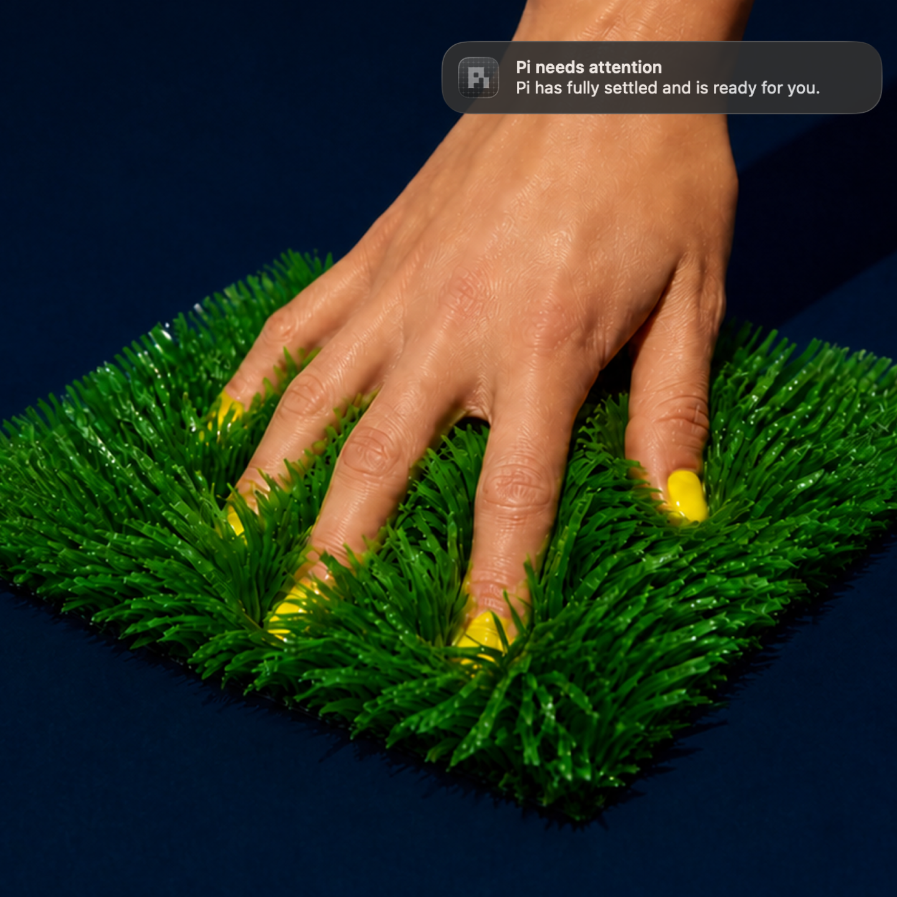
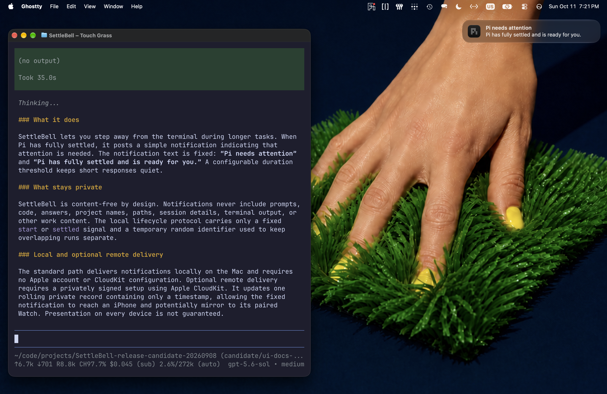

# SettleBell

<picture>
  <source media="(prefers-color-scheme: dark)" srcset="Assets/Communication/settlebell-teaser-dark.webp">
  <source media="(prefers-color-scheme: light)" srcset="Assets/Communication/settlebell-teaser-light.webp">
  
</picture>

*Teaser artwork reused unchanged from PiPing `v0.1.0`; the original files
remain preserved under their PiPing filenames.*

Stop watching the terminal. When a long-running Pi task has fully settled, SettleBell
sends a simple notification to your Mac, so you can go do something else while
your agent works. With optional private Apple signing and CloudKit setup, the
same signal can also reach your iPhone and mirror to its paired Apple Watch — so
you can be outside and still know when Pi is ready for you.

The notification is always:

- **Pi needs attention**
- **Pi has fully settled and is ready for you.**
- the normal system notification sound

The message never includes your task, prompt, model output, code, project, or
file names. SettleBell receives only a fixed `start` or `settled` signal and a random
per-cycle UUID so overlapping runs stay independent. That UUID exists briefly in
the Pi extension and Mac app, is not Pi's session identifier, and is never sent
to CloudKit. If remote delivery is enabled, CloudKit stores one timestamp; the
notification text is fixed in source and subscription configuration.

See [Privacy](Docs/PRIVACY.md) and the
[Threat model](Docs/THREAT_MODEL.md) for the complete boundary.

> SettleBell is an independent community project and is not affiliated with or
> endorsed by Pi's maintainers. It is a convenience notification, not an alarm
> or safety-critical system. Phase 1 is intentionally one-way: no commands,
> replies, or approval actions.
>
> **Rename status:** SettleBell is the side-by-side successor to PiPing. The
> PiPing `v0.1.0` release remains immutable historical provenance; SettleBell's
> first developer preview is `0.2.0`. See
> [Migrating from PiPing](Docs/MIGRATING_FROM_PIPING.md).

## What you need

| | |
| --- | --- |
| **macOS** | macOS 26 or later |
| **Xcode** | Stable Xcode 26 or later at `/Applications/Xcode.app`; use the latest stable full Xcode available because Command Line Tools alone cannot compile the Icon Composer source |
| **Swift** | Swift tools 6.2 or later, supplied by the supported Xcode toolchain |
| **Node** | The Node runtime used by your existing Pi installation, with type-stripping support for hook tests |
| **Pi** | Version-specific acceptance; see [tested compatibility](#tested-pi-compatibility) for versions and scoped results |
| **Local installation** | The invoking user must already have write access to `/Applications`—normally an administrator account. No `sudo` or password prompt; standard-account installation is not supported/accepted in this preview |
| **iPhone / Watch delivery** | Optional; iOS 26 or later plus your own Apple account, signing identity, and private CloudKit container |

The Apple version numbers above are minimum baselines, not exact-version locks.
Newer stable Apple releases are expected to work but are confirmed as they become
available. Pi compatibility remains version-specific because its extension
lifecycle APIs can change.

SettleBell `0.2.0` is a source-only developer preview.
This source snapshot does not include an official downloadable app binary.
App/archive validation also requires Python 3 available as `python3` on `PATH`
(for example, from the installed Xcode Command Line Tools). No script installs it.

## Choose a path

| What you want | Start here |
| --- | --- |
| Mac notifications without an Apple account | [Mac-only local build](#mac-only-local-build) |
| Mac, iPhone, and paired Watch delivery | [Signed local build](#signed-local-build) |
| Tests and compile verification only | [Verify from source](#verify-from-source) |
| Try the Pi extension for one run without saving it | [One-run Pi trial](#one-run-pi-trial) |

Whichever app path you choose, install or temporarily load the Pi extension to
connect Pi's lifecycle events to the native Mac app.

## How it works

A small Pi extension translates the documented `before_agent_start` and
`agent_settled` lifecycle events into fixed signals. A bundled native helper
writes those signals to a protected same-user FIFO. The Mac app applies your
duration threshold and posts a local notification.

If you explicitly enable iPhone / Watch delivery in a privately signed build,
the Mac updates one rolling record in your private CloudKit database. The iPhone
app subscribes to that fixed record, and Apple can mirror its notification to a
paired Watch. There is no watchOS app. The first SettleBell migration preserves
PiPing's deployed v1 CloudKit record type, rolling-record name, and subscription
ID as internal compatibility identifiers; changing them requires a separate
migration review.

See [Architecture](Docs/ARCHITECTURE.md) for the complete data flow.

## What it looks like in use

<picture>
  <source media="(prefers-color-scheme: dark)" srcset="Assets/Communication/settlebell-hero-dark.webp">
  <source media="(prefers-color-scheme: light)" srcset="Assets/Communication/settlebell-hero-light.webp">
  
</picture>

Open the image full-size to read the terminal explanation. The terminal content
is not part of the notification: task details stay in Pi, and SettleBell receives
only the lifecycle signal needed to decide when to notify. The original PiPing
hero images remain unchanged in the assets directory as historical provenance.

## Mac-only local build

This is the simplest functional path. It provides local Mac notifications
without an Apple account, signing identity, or CloudKit container. Full stable
Xcode is still required because the app uses Apple Icon Composer source.

From a trusted checkout:

```bash
./script/verify.sh
./script/build_source_local.sh
./script/install_source_local.sh --check
./script/install_source_local.sh --install
```

The installer uses the public development identity, keeps CloudKit disabled,
and refuses to replace a private, foreign, or future official app. Generated
archives remain local-only and are not release artifacts.

See [Setup](Docs/SETUP.md) for guarded uninstall and rollback instructions. If
PiPing is already installed, follow the separate
[side-by-side migration guide](Docs/MIGRATING_FROM_PIPING.md); no SettleBell
installer overwrites PiPing. If an agent will run the commands, read
[Agent-assisted installation](Docs/AGENT_INSTALL.md) first.

## Signed local build

Developers with their own ignored Apple signing and private CloudKit
configuration can build the optional iPhone / Watch path:

```bash
./script/build_signed_local.sh
./script/install_signed_local.sh --check
./script/install_signed_local.sh --install
```

The signed archive can contain account-specific identifiers and entitlements.
Keep it local and never attach it to a public release. The complete configuration
and validation rules are in [Setup](Docs/SETUP.md).

## Verify from source

To run tests and public-safe macOS/iOS Release compile verification without
launching an app, contacting CloudKit, or sending a notification:

```bash
./script/verify.sh
```

To stage the unsigned Mac compile-verification archive without launching it:

```bash
./script/build_and_run.sh --build-only
```

This produces `dist/unsigned/SettleBell.app.zip`, labeled **SettleBell Development**.
It is a compile-verification artifact, not an official binary release, and the
build-only flow retains no discoverable application bundle.

## Connect Pi to the app

Installing the native app does not automatically install the Pi extension. From
the repository root, add it through Pi's package mechanism:

```bash
pi install .
```

New Pi sessions then load it normally. In an existing session, use `/reload`.
Remove the same local package source with:

```bash
pi remove .
```

The extension invokes only the installed helper at:

```text
/Applications/SettleBell.app/Contents/Helpers/SettleBellSignal
```

It never falls back to a repository, DerivedData, `dist`, or backup executable.
If the canonical helper is unavailable, it reports a generic availability error
to Pi without exposing task content.

### One-run Pi trial

To load the extension for one session without changing Pi's saved package
configuration:

```bash
pi --extension Integration/Pi/settlebell.ts --no-session --tools read,grep,find,ls
```

Exit that Pi process when finished. Nothing was installed, so there is no package
to remove.

## Check an installation

After installation, run the read-only canonical-app check:

```bash
./script/check_local_installation.sh
```

This selects the source-local or private-signed validator from the canonical
app's identity. It never falls back to another validator after a failure.
`check_installation.sh` remains the private-signed-only check used by the signed
installer.

To inspect toolchain availability, public defaults, private-override presence,
prospective configuration, and Git state without printing private values:

```bash
./script/status.sh
```

Outside a Git checkout (for example, an extracted source release), Git-based
file inventory is explicitly unavailable; the canonical installation check still
runs. This diagnostic is not a substitute for the release privacy audit.

Notification permission, LaunchServices metadata, and icon caches are keyed to
the macOS bundle identifier. Changing the identifier in ignored
`Config/Local.xcconfig` creates a new notification identity.

## Notification threshold

SettleBell notifies after 30 seconds by default, so fast responses stay quiet. In
**SettleBell > Settings**, **Notify me** offers:

- every completion;
- after 15 seconds; or
- after 30 seconds.

## Icon appearance on macOS 26

Window appearance and icon appearance are separate macOS settings. If SettleBell's
Dock or notification icon stays light, open **System Settings > Appearance**,
choose **Dark** under **Icon & widget style**, and select **Auto** rather than
**Always**. SettleBell includes native Light and Dark renditions but does not inspect
or change this user preference. See [Setup](Docs/SETUP.md) for full guidance.

## Tested Pi compatibility

| Pi version | Package load | Ordinary >30s turn | Notes |
| --- | --- | --- | --- |
| 0.84.3 | Passed | Passed | Original lifecycle acceptance baseline |
| 0.84.4 | Passed | Passed | Original PiPing developer-preview acceptance baseline |
| 0.85.1 | Passed | Passed | SettleBell private development acceptance; Mac and paired Watch delivery observed |
| 0.87.1 | Passed | Owner-reported | Separate-machine Mac-only test on macOS 27.0, SettleBell 0.2.0 (17), commit `bd531628`; iPhone/Watch and broader release acceptance not tested on this setup |
| 1.0.4 | Owner-observed lifecycle result | Owner-reported | macOS 27.0.1, existing private SettleBell 0.2.0 (17), hook byte-identical to `bd531628`; a measured 35-second tool wait in an ordinary turn was followed by an owner-confirmed Mac notification; no new iPhone/Watch acceptance |

The native app and helper do not depend on Pi internals. The TypeScript edge does
depend on `before_agent_start`, `agent_settled`, and `context.isIdle()`, so other
Pi versions are not yet claimed compatible. The macOS 27 results are scoped to
the listed local tests, not a general newer-OS compatibility guarantee.

## Project status

The Phase 1 path has functional acceptance on private development builds:
an ordinary Pi task settled, the Mac notified, and optional CloudKit-backed
notification routing reached the paired Watch after iPhone setup. Normal daily
use has also been accepted. This is not a guarantee of exactly-once delivery or
presentation on every device.

Two overlapping real Pi sessions passed on the original PiPing baseline.
SettleBell has controlled-overlap acceptance and automated lifecycle coverage
for 50 overlapping tokens; a live 5–10-session SettleBell stress test remains
unverified. In a separate-machine local test, the owner reported a Mac
notification after trying the proposed 35-second Pi 0.87.1 test prompt on
macOS 27.0, using source-local SettleBell 0.2.0 (17) from commit `bd531628`.
Elapsed time and notification presentation were not independently captured.
Acceptance applies only to the tested revisions and configurations; it does not
establish clean-user readiness for every source snapshot. Each release requires
the [exact-revision validation gates](Docs/RELEASING.md).

The Mac listener starts with the application lifecycle, including Login Item
launches where no main window appears. Remote delivery is reported as sent only
after CloudKit accepts the write; that confirms the database update, not display
on every device.

Phase 1 intentionally has no command channel, notification action, App Intent,
deep link, dashboard, project or file view, session metadata, terminal identity,
or approval surface. Any future action vocabulary would be a separate security
boundary and design review.

## Documentation

- [Setup and verification](Docs/SETUP.md) — build, install, uninstall, and rollback paths
- [Migrating from PiPing](Docs/MIGRATING_FROM_PIPING.md) — side-by-side identity, retirement, and rollback boundaries
- [Agent-assisted installation](Docs/AGENT_INSTALL.md) — approval boundaries for agent-run setup
- [Architecture](Docs/ARCHITECTURE.md) — data flow, components, and delivery behavior
- [Privacy](Docs/PRIVACY.md) — allowed and prohibited data
- [Threat model](Docs/THREAT_MODEL.md) — assets, trust boundaries, and assumptions
- [Security policy](SECURITY.md) — invariants and private vulnerability reporting
- [Contributing](CONTRIBUTING.md) — change rules and required verification
- [Releasing](Docs/RELEASING.md) — maintainer release process
- [Release audit](Docs/RELEASE_AUDIT.md) — exact-candidate publication checks
- [Notification icon repair](Docs/MACOS_NOTIFICATION_ICON_REPAIR.md) — native icon troubleshooting

## License and releases

SettleBell source and assets are available under the [MIT License](LICENSE).
Contributions are welcome under [Contributing](CONTRIBUTING.md).

PiPing `v0.1.0` remains a source-only historical release. SettleBell `0.2.0` is
also a source-only developer preview. Locally generated ad-hoc or Apple Development-signed apps and
`dist/` output are not public release artifacts. A future downloadable Mac
binary requires Developer ID Application signing, notarization, stapling, and a
separate exact-binary audit. See [Releasing](Docs/RELEASING.md).
